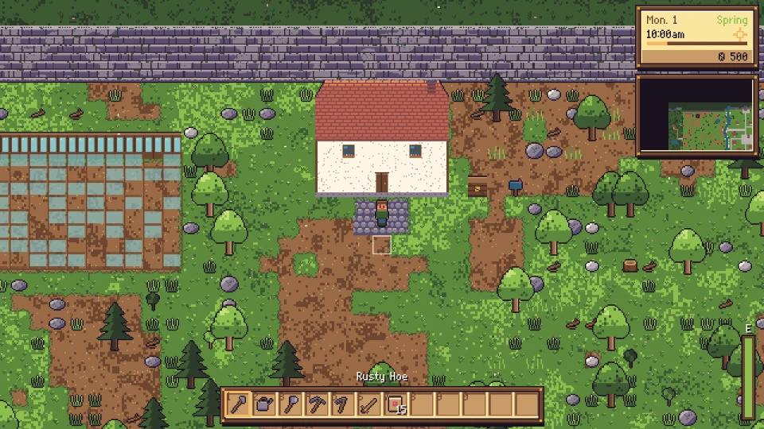
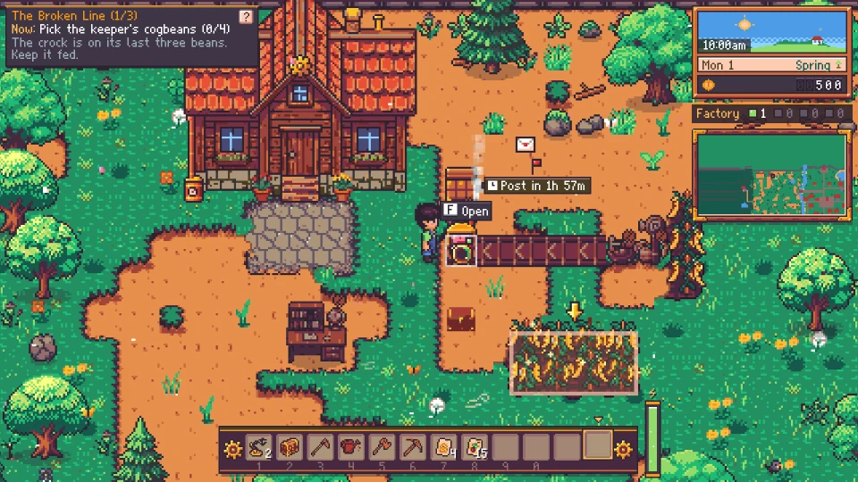

# Sprocket & Sprout patch notes

## 2.1 (October 2026)

**Overseas**

2.1 opens the Harbor: late in the game, a merchant ship calls at the beach pier for your exports, in amounts only a factory can make. It also brings together every fix and update since 2.0.

### The Harbor: exports overseas

- Late in the game, after the tram runs, the town can rebuild the old harbor warehouse at the beach pier ("Rebuild the Harbor" on the Works tab).
- Once it's open, the merchant ship the Copper Gull calls at the pier. Each visit it brings a manifest from a port across the sea: three to five goods in huge amounts, like 300 iron bars, 600 brass gears or 2,000 glass.
- Each port wants different things: Brassmouth buys metal and parts, Port Verdance food and preserves, the Ember Isles wine and luxuries, Saltspire timber, rope and canvas, Kettleholm tea, baking and cloth.
- A manifest only asks for goods in season that your farm has made.
- Everything pays as it goes aboard, well above the market, and never lowers market prices. Load a manifest in full and you get a big bonus on top, and the ship sails a day early.
- The ship stays a week, then sails with whatever is aboard and comes back three days later.
- Load goods by hand at the warehouse door (F), with Hand in on the Orders board's new Exports tab, or tag a shipping crate for the Harbor. A crate tagged for the Harbor keeps its goods while the ship is at sea instead of selling them.
- Your standing with the Harbor grows with every manifest you fill (or at least half fill). Six ranks, from Dockhand to Merchant Prince, each with a letter and coins from the Harbormaster, better prices and bigger manifests.
- Manifests can be tracked like any other order.

### Orders

- You can track orders: press Track on any order on the Orders board and a small checklist of it shows under your quest at the top left, ticking off each item as it goes in. Click it to open the board, or x to stop tracking. Up to four at once.
- Orders ask for things that are in season: no bread or flour in winter, when no grain grows, and no pickled cogbeans in fall or winter. A shop's weekly order takes a break until its season comes back, and the Orders board says when.
- Quests that ask for sprout bundles mention the quick way: a plant fiber with a coconut or anything else from the beach.
- A keystone's "keep a line making ... a minute" step counts as soon as the line runs, even before you've done the steps listed above it.
- The Milling step that asks you to keep a mill grinding is clearer: it shows how fast your mill is going and how to pass it, and cornmeal counts as meal.
- Later research costs less and climbs more evenly: the last era's topics ask 35 to 50 of each bundle instead of 50 to 80.

### Machines

- Arms keep loading a machine while it's working, about ten minutes of work ahead, instead of waiting for each batch to finish.
- The field gantry's seed bin has no limit: arms or your hands can put in as many seeds as you like, and they no longer take space from the crops. Its window shows the bin; click a seed to take it back.
- A field gantry no longer disappears when you stand near its bridge while it's out along its rails.
- A field gantry rides its rails whichever end of them you put it at.
- Drills bring up rare ores more slowly: copper and stone come fast, iron at under half the speed, gold at about a seventh. The drill says what it's drilling.
- You can fuel a steam drill yourself: hold coal or wood and press F, or shift-click fuel in from your bag.
- The Harvest Crane can be turned with R to face any of four ways.
- Hover over a placed scarecrow, sprinkler, harvest crane, seed sower, gleaner, power pole or hive to see what it reaches.
- Buttons in a window's top corner, like a chest's Sort, no longer sit under its close button.

### Farming and the valley

- Cotton ripens in 7 days instead of 8.
- Hover over a crop to see what it is, how many days until it's ripe, whether it's been watered today and which seasons it grows in.
- You can pull up a crop by swinging your axe or pickaxe at it twice. A ripe one drops its harvest.
- Crops planted right against the greenhouse's back wall can be harvested.
- The beach washes up two or three new finds every morning. Kelp turns up a bit more often, and beach palms grow one or two coconuts at a time.
- A fish trap that's already baited no longer takes another bait.

### Music, art and more

- New music: three songs, Clockwork Morning, Sprout Lane Waltz and Lamplight, that take turns. Press N, or Next in Settings, to skip to the next song.
- The pickaxe swing facing up or down no longer looks broken, for every look.
- The ladders in the mine are redrawn.
- New pixel art for the Harbor: the warehouse at the pier (with snow on its roof in winter), the Copper Gull at anchor and under sail, and the cargo stacking up as you load.
- On the website, the title screen has a Download for Windows button. The Windows download is now a single installer.

### Updates

- The Prism Shard can now be found: the first starstone you break at the bottom of the Deepworks (level 30) holds one, and later ones sometimes do. Before this, nothing gave one, so the Starlight Beacon could never be finished.
- Master Angler now counts the shellfish your fish traps bring up (crayfish, periwinkles, mussels, shrimp, lobsters and shore crabs). They never bite a line, so it could not be earned before.
- A last quest from the Mayor after Grand Works: Wonders of the Valley, finish all three megaprojects. It comes with a new achievement of the same name.
- Hover an item on a Grand Works Site to see where to get it, and the site's reward no longer runs off the edge of the window.

## 2.0 (October 2026)

**The Works**

2.0 rebuilds Sprocket & Sprout around its machines. You take over an old keeper's clockwork farm that has rusted to a stop, bring it back piece by piece, then help the town restart its mill, water pumps, street lamps, tram and clock with production lines you build yourself. Hand farming is still here, and your farms from earlier versions come with you.

| Then: the first build (v0.9) | Now: 2.0 |
|---|---|
|  |  |

### The big picture

- Your farm runs on machines from the first minute. Arms, belts and crocks do the carrying, and your job is to build lines and make them better.
- You can still till, plant, water and harvest by hand whenever you like.
- One story path for everyone: start in the keeper's yard, then bring back the town's mill, waterworks, street lamps, tram and clock.
- Every machine tells you what it is doing and why it stopped, so a stuck line is a puzzle you can solve instead of a mystery.

### A new start: the Keeper's Line

- Every new game opens in the old keeper's yard. One preserving crock still works, and everything around it has rusted.
- Press F on rusted arms, belts and machines to restore them. Within minutes a small line turns beans into pickles and carries them to the shipping crate without you.
- The quest bar at the top left shows one step at a time, with a short reason why.
- Lesson cards appear the first time something new happens, like a machine running out of input or a power shortage. The Keeper's Notebook (J) keeps them all.
- Within the first few days you fix the keeper's water wheel and grind your first sacks of meal at the mill.

### Machines and lines

- Every machine shows what it is doing (Working, Idle, Starved, Blocked, Unpowered or Needs fuel) with one line saying why.
- Hold I over a line to see how fast it runs and what holds it back. The Lines tab in the Production window (P) lists every line and its bottleneck.
- Four lamps under the clock count your working and stuck machines. Click one to find them.
- Shift+F opens a machine to pick its recipe. Right-click a spring arm or gleaner to wind it for a short burst of speed.
- Power can run short. When it does, everything on that grid slows down and the lights dim. Power poles switch their machines on, off, or to night shift only.
- Your machines keep working through the night, and the morning summary names yesterday's biggest bottleneck.

### Fields that farm themselves

- The gleaner picks the ripe crops around it. Later, the field gantry rides on rails to water, harvest and replant whole strips.
- Machines leave each morning's harvest to you until noon, so farming by hand always pays.
- New goods to make: canvas, grain and straw, starch paste, pigments, rapeseed oil and grain spirit.
- Cogbeans grow twice as fast, and the Mercantile sells their seeds.

### The town is your customer

- The Orders board on the town square lists what the town wants: small asks for today, weekly standing orders, and the town's big projects.
- Fill an order by hand, or tag your shipping crate for a customer and the post delivers it for you.
- Each business you supply ranks you up, which opens new orders and new stock in its shop.
- Mags the freight broker visits on Fridays and Sundays with rare parts and seeds, and runs an auction on Sundays.

### Research and the town's works

- Research comes in five eras, from Spring to Starlight. After the keeper's yard, each era brings back part of the town: the mill, the waterworks and street lamps, the tram, and last the town clock.
- Big research topics come in stages: look at the real thing, try it yourself, then study it at the desk.
- When a town work comes back, the town changes with it: bread returns to the shops, the fountain runs, and the square lights up at night.

### The Deepworks

- The old mine is now the Deepworks: 30 levels in six layers, each with its own look, ores and dangers.
- Monsters are gone. Pests get in your way instead and never hurt you, and every hazard has a fix.
- Every fifth level holds an old machine room to restore, starting with a lift that takes you back down.

### People

- Six villagers take up jobs at the works: Juniper the millwright, Bram the foundry master, Sable the archivist, Old Thorne the engineer, Hazel the draughtswoman and Pip the apprentice.
- Friendship is now Trust, and helping with work builds it faster than gifts.
- Pip quizzes you on what you have learned, and some afternoons asks what one of your machines is doing.
- Villagers at work indoors can be talked to at their counter.

### Festivals, home and pets

- The Sprocket Fair: enter a small line on the Professor's test plate in the square and see if it beats the other entries.
- The Harvest Haul: every standing order pays double for the day, and the Mayor holds an auction.
- Chests and unpowered machines can go inside your farmhouse. Add a Workshop Wing, and a drafting table to save your lines as blueprints.
- A hamster moves in, and its wheel speeds up the spring arms near its cage. Later, Tock, the Professor's clockwork helper, follows you around winding your arms.

### Art and sound

- New pixel art across the valley: the keeper's works, conveyor belts, the town's works, every layer of the Deepworks, the festivals, and the villagers in their work clothes.
- New sounds for winding springs, stopped machines and switching the power.

### Your saves

- Farms from 1.x and the 2.0 beta load with nothing lost. Older farms skip the new opening and carry on with their story.
- A farm saved in 2.0 can't be opened in 1.1.1 or earlier.

### Since the 2.0 beta

- A smoother opening: clearer steps, no waiting around, and the camera starts closer to your machines.
- F always acts on the tile in front of you, even with a villager standing beside it.
- Tooltips, labels and messages no longer cover each other.
- Crafting and item tooltips tell you where to get materials and parts.
- Farms from 1.x get the cogbean oil recipe and, after Water Power, a mill, so they can keep going.
- The game remembers how far you zoomed in.
- New art for the villagers, the festivals, the belts, the crock and the farmhouse.

## 2.0 beta (October 2026)

**The Works, first test**

The first public test of 2.0. Everything it added is in the 2.0 notes above.

## 1.1.1 (October 9, 2026)

**Playtest hotfix**

A hotfix from the first playtests of 1.1: the ranch opens, bridges are square, mine lifts remember shafts, and the map names every building and shows every villager. Paths, plank decks and the ground where two terrains meet look better too.

### Fixes

- Meadowlark Ranch opens: a villager waiting on a doorstep now steps straight in, so Clem finally gets inside.
- Bridges are rectangles: no more L-shaped decks or strips of plank along the bank, on every farm map. Old saves are squared on load.
- A shaft that drops you past floor 5, 10 and so on unlocks those lifts, and the lift lists every floor down to your deepest. Old saves get every lift above their deepest floor.
- Shift-click moves stacks between your bag and a chest, ctrl-click moves one, and double-click moves every stack of a kind.
- Structure windows have a Pick up button, tools take three hits to lift a structure, and a chest or crate with anything in it never breaks by tool.
- Weeds and twigs no longer block your way, and screen shake is gentler (and off with the Screen shake setting).
- Weeds and storm debris stay off the opening's marked tiles, which on some new games blocked the first arm step.
- One name for the Professor everywhere, Prof. Cogwhistle, and a name tag over the villager the guide arrow points at.
- Less mail: quests send no letters, the almanac keeps season notes, festivals and birthdays, and the mailbox brings at most one letter a day.
- The research tree pans with the mouse wheel (Shift+wheel sideways), with scrollbars and a Fit overview.
- Jars cost the same in every shop, the crate's pop shows what the market really pays, and the 960x600 web embed keeps the larger UI.

### Look and feel

- The map (M) labels every shop and home without overlap. Hover for the name, opening hours and who is inside; heads show you and every villager.
- Flagstone paths with gravel edges, for your own paths and the town's roads. Cobble Path is now Flagstone Path.
- Plank decks with rails over water, and a path you place now really changes the ground.
- Where two kinds of ground meet, the edges blend instead of leaving square notches, tilled soil included.
- The pickaxe swings overhead like the hoe, for every look.

## 1.1 (October 9, 2026)

**The visual overhaul**

Every sprite is redrawn as pixel art on one warm palette, the keeper's clockwork farm runs from your first minutes, and a new villager moors her airship at the end of Main Street. Saves from 1.0 load as they are.

### New look

- Every sprite is redrawn as pixel art on the warm Resurrect 64 palette: terrain, crops, characters, machines, buildings, icons and the UI.
- Crops arc into your hotbar, harvest streaks build (every tenth pick in a streak gives a bonus crop), coins shower into the odometer, and machines hop and pop their goods.
- A brass mail-bird collects the noon and 6pm post, and the night tally counts up row by row.
- Machines show a status lamp (working, waiting for input or blocked), and up close a ring that fills with each batch.
- Shadows under trees and structures, smoke from each machine's chimney, wind gusts that sway the trees, and a title wordmark with the sprocket as its O.

### A better first day

- The keeper's clockwork farm runs from your first minutes: chest, arm, jar, arm, crate.
- Key bubbles show what F does on whatever you face, and a guide arrow and compass point the way.
- Belts drop goods into whatever they run into (a crate, chest or machine), so no arm is needed at the end of a line.
- Prof. Cogwhistle welcomes you in three short lines, and there's no dead afternoon on day one.

### New villager: Roxy Vane

- A sky-courier who moors her airship, the Brass Vixen, on Skyhook Field at the east end of Main Street. She sends you a card on day 4.
- Her hold sells off-season seeds and clockwork parts, and she has her own story over four heart events. She can become your partner.

### Also

- The UI stays readable on 1366x768 laptops, and the new-game form works with Tab and Enter.
- Artisan goods flood the market more slowly, and the night tally warns you when one is flooding.
- A finished study shows a Discovery! ribbon naming what it unlocked.
- The derelict greenhouse is an ordinary seasonal plot until you restore it for year-round growth.
- Installing over 1.0 keeps your farms.

## 1.0 (October 8, 2026)

**First release**

The first release of Sprocket & Sprout, a cozy pixel-art farm-factory in the valley town of Thistlewick: farm by hand, build belts, arms and machines around your fields, and help the town back on its feet.

### Farming and home

- 36 crops across four seasons, with watering, sprinklers, fertilizers, silver, gold and star quality, giant crops, fruit trees and a ruined greenhouse to restore.
- Coops and barns with eight kinds of animals, fishing with an original tension-reel minigame, and a 60-floor mine with ores, gems, monsters and treasure.
- A walk-in farmhouse with renovations, home cooking with timed food buffs, furniture, and a stray cat or dog that adopts you on day 3.

### The factory

- Two-lane belts in three speeds, with curves, side-loading, underground belts and splitters, and spring-wound clockwork arms that need no power.
- More than 20 machines with real recipes, and power from water wheels, windmills, steam engines and sun lenses, carried by poles and stored in spring batteries.
- Harvest cranes, seed sowers, ore drills on the quarry's veins, and bumblebots that carry goods and build for you.
- Blueprints you can copy, rotate and paste, ghosts that build themselves from your bag when you're near, and production stats with graphs.
- A 60-node research tree, studied at desks with bundles made from farm and factory goods.

### Town and goals

- 13 villagers with schedules, dialogue, gifts, birthdays and heart events, who teach you recipes as friendships grow.
- Shops with opening hours, Mags' traveling cart on Fridays and Sundays, and a market that pays less for whatever you flood it with.
- Four festivals with minigames, Trading Guild contracts, a restoration board, three megaprojects, a museum, and Founder's Day each spring.
- Romance: give the Brass Locket to a villager you love.

### Ways to play

- A clockwork opening: you start beside the keeper's working jar with arms, belts, a chest and a study desk.
- Four game modes (Story, Cozy, Clockwork Rush and Sandbox) and five farm maps.
- About 120 achievements, around 35 of them secret.
- The post collects at noon and 6pm as well as overnight, passing out costs your morning instead of your coins, and the world slows down while you build.
- Procedural music and sound. Play in your browser, where it installs as an app, or download it for Windows.
